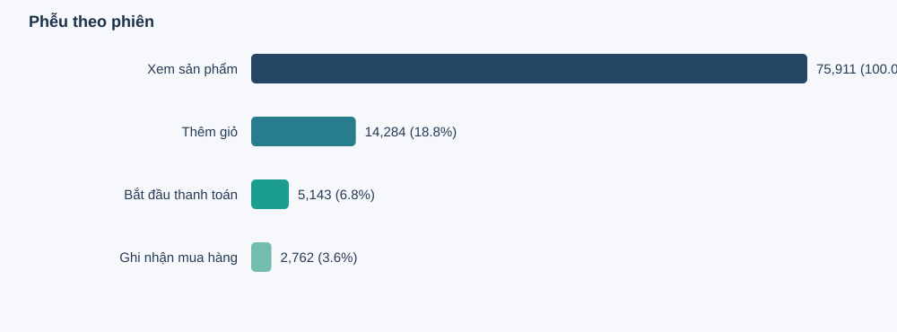

# GA4 Product Analytics — purchase funnel in BigQuery SQL

[](https://github.com/ZackingZ2006/ga4-product-analytics/actions/workflows/ci.yml)

Session-level purchase funnel (view item → add to cart → begin checkout → purchase) built in BigQuery SQL on Google's public [GA4 sample e-commerce dataset](https://developers.google.com/analytics/bigquery/web-ecommerce-demo-dataset) (Google Merchandise Store, obfuscated).

🇻🇳 Báo cáo tiếng Việt: [reports/bigquery/bao_cao.md](reports/bigquery/bao_cao.md)



## Result

Sessions starting 2020-11-02 → 2021-01-30. There are 354,655 eligible sessions, and 75,911 of them viewed a product.

| Step | Sessions | From previous step | From view |
|---|---:|---:|---:|
| View item | 75,911 | — | 100% |
| Add to cart | 14,284 | 18.8% | 18.8% |
| Begin checkout | 5,143 | 36.0% | 6.8% |
| Purchase | 2,762 | 53.7% | 3.6% |

- **The biggest drop is view → cart:** 81% of viewing sessions never add anything to the cart.
- **Device barely matters:** view-to-purchase is 3.5% on desktop, 3.8% on mobile and 3.6% on tablet.
- **Time to buy:** among sessions that complete the funnel, the median time from first view to purchase is about 14 minutes, and the 90th percentile is about 41 minutes.
- **Timestamp sensitivity:** many events share the same timestamp, so their order is unknown. The strict funnel requires each step to come strictly after the previous one and gives 2,762 purchases. Allowing ties (weak mode) gives 2,818. The headline numbers use strict.

## SQL pipeline

[sql/01_ga4_funnel.sql](sql/01_ga4_funnel.sql) runs as one multi-statement script using TEMP tables only:

1. **Staging:** unnest `event_params` and keep repeated events (there is no reliable event id).
2. **Data quality:** count excluded events, duplicate parameter keys and missing amounts.
3. **Session mart:** grain = `(user_pseudo_id, ga_session_id)`, because `ga_session_id` alone is not unique.
4. **Order mart:** keep one row per `transaction_id`; quarantine orders seen with several users or amounts.
5. **Ordered funnel:** each step must happen after the previous one in the same session.
6. **Quality contracts:** `ASSERT`s stop the script before any KPI is exported if the funnel is inconsistent.
7. **Outputs:**
   - KPIs and funnel by device,
   - Wilson intervals by device,
   - first-user acquisition source,
   - daily trend, time to purchase, product exposure,
   - timestamp ties.

Other scripts:
- [sql/00_profile.sql](sql/00_profile.sql): schema check and a two-day profile before the full run.
- [sql/00_estimate_scan.sql](sql/00_estimate_scan.sql): estimate bytes scanned with a dry run.
- [sql/03_diagnostics_segments.sql](sql/03_diagnostics_segments.sql): device × traffic source breakdown.

## Run

**BigQuery:** you need a Google Cloud project (the free BigQuery Sandbox works). Run `00_profile.sql`, then dry-run `00_estimate_scan.sql` to check the scan size. Then run `01_ga4_funnel.sql` as a single script. For weak mode, set `strict_order = FALSE`. Export the result tables to `results/` as CSV.

**Offline (Python 3.9+, no external packages):**

```bash
python -m unittest discover -s tests -v
python scripts/build_report.py --input results/bigquery_strict --weak results/bigquery_weak \
  --mode source --job-id <bigquery_job_id> --output reports/bigquery
```

- The tests run the funnel logic on a small hand-made fixture in SQLite and check the report builder.
- Numbers in `tests/fixtures/` are made up and the generated report is watermarked as such.

## Limitations

- The dataset is obfuscated by Google and may be internally inconsistent. The results describe this sample only.
- Session-level funnel: a session can view one product and buy another.
- `traffic_source` in GA4 export is the user's **first** source, not the session's source.
- Differences between devices or sources are observational, not causal.
